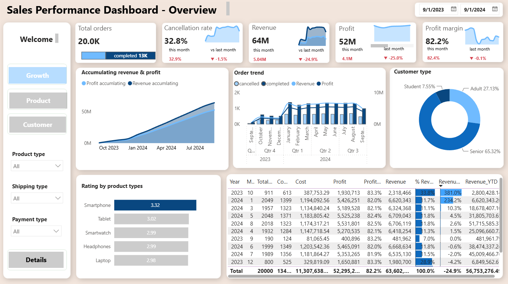
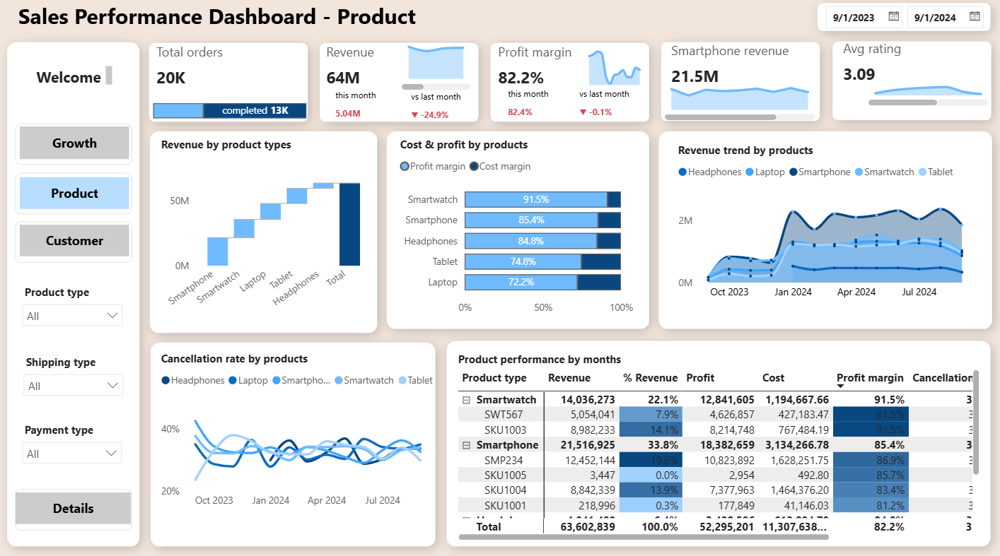
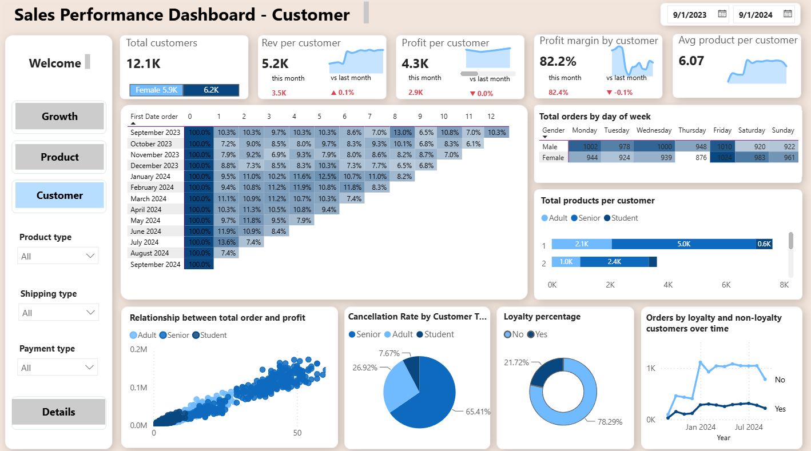
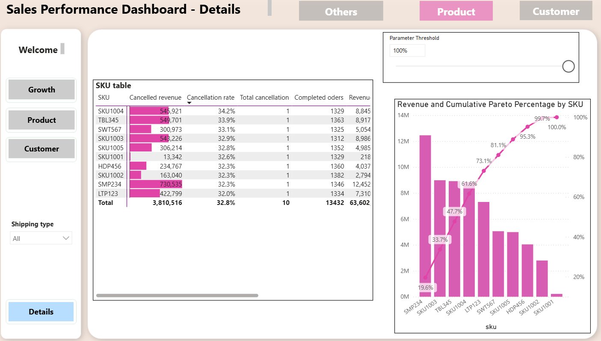

# Electronic Sales Power BI Analysis

## Project Overview

This project analyzes electronic product sales data using Power BI to evaluate business performance, product performance, customer behavior, order cancellations, payment preferences, shipping methods, and sales trends.

The dataset contains **20,000 orders** covering the period from **September 2023 to September 2024**.

The project demonstrates an end-to-end Business Intelligence workflow, including data cleaning, dimensional modeling, DAX calculations, interactive dashboard development, and business insight generation.

---

## Business Questions

This project was designed to answer the following business questions:

- How are revenue, profit, and orders performing over time?
- How does monthly performance compare with the previous month?
- What is the overall cancellation rate?
- Which product categories generate the most revenue?
- Which products have the strongest and weakest performance?
- How do profit margin and cost vary across product categories?
- What customer groups contribute most to business performance?
- How do loyal and non-loyal customers behave differently?
- Which payment methods are used most frequently?
- How do shipping methods affect completed and cancelled orders?
- Which products contribute most to total revenue?
- How does customer retention change over time?

---

# Dataset

The original dataset contains:

- **20,000 orders**
- **12,136 unique customers**
- **13 products**
- **5 product categories**
- More than **109,000 units ordered**
- Transaction dates from **September 24, 2023 to September 23, 2024**

### Main Fields

- Order ID
- Customer ID
- Age
- Gender
- Loyalty Customer
- Product Type
- SKU
- Rating
- Order Status
- Payment Method
- Total Price
- Unit Price
- Quantity
- Purchase Date
- Shipping Type
- Cost

### Dataset File

The dataset used for this project is included in the repository:

```text
data/dataset_electronic.csv
```

---

# Data Cleaning & Transformation

Several data preparation steps were performed before building the dashboard.

These include:

- Standardizing column names
- Correcting data types
- Converting purchase dates into date format
- Creating product identifiers
- Creating payment identifiers
- Creating shipping identifiers
- Separating fact and dimension tables
- Creating customer segmentation fields
- Creating age-based customer groups
- Creating shipping categories
- Creating payment categories
- Building a dedicated Calendar table
- Creating supporting measures for time intelligence
- Preparing fields for Month-over-Month analysis
- Preparing measures for customer retention analysis
- Preparing measures for Pareto analysis

A payment naming inconsistency was also identified in the source data:

```text
PayPal
Paypal
```

These values should be standardized during data preparation to avoid treating them as separate payment methods.

---

# Data Model

The Power BI project uses a **Star Schema** centered around the `fact_order` table.

## Fact Table

- `fact_order`

## Dimension Tables

- `calendar`
- `dim_customer`
- `dim_product`
- `dim_payment`
- `dim_shipping`

## Supporting Analytical Tables

The Power BI model also contains supporting tables used for advanced analysis, including:

- Measure table
- Month-offset table
- Parameter Threshold
- Pareto Measure

### Model Structure

```text
                 calendar
                    │
                    │
dim_customer ── fact_order ── dim_product
                    │
                    │
              dim_payment
                    │
                    │
              dim_shipping
```

The dimension tables filter the central fact table through one-to-many relationships.

This structure improves model performance, measure consistency, and analytical flexibility.

---

# Dashboard Pages

The Power BI report contains four main analytical pages.

---

## 1. Sales Performance Dashboard - Overview

This page provides an executive-level overview of business performance and growth.

Key metrics and analyses include:

- Total Orders
- Revenue
- Profit
- Profit Margin
- Cancellation Rate
- Monthly Revenue
- Monthly Profit
- Month-over-Month Performance
- Revenue Accumulation
- Profit Accumulation
- Revenue Contribution
- Revenue YTD
- Completed Orders
- Cancelled Orders
- Average Product Rating
- Customer Age Distribution
- Product Performance
- Payment Type Filters
- Product Type Filters
- Shipping Type Filters
- Monthly Date Filters



---

## 2. Sales Performance Dashboard - Product

This page focuses on product portfolio performance.

Key analyses include:

- Total Revenue
- Total Orders
- Profit Margin
- Average Product Rating
- Smartphone Revenue
- Revenue by Product Type
- Revenue Trend by Product Category
- Profit Margin by Product Type
- Cost Margin by Product Type
- Cancellation Rate by Product
- Monthly Product Performance
- Revenue Contribution by SKU
- Product-Level Profit
- Product-Level Cost
- Order Trends
- Completed vs Cancelled Orders



---

## 3. Sales Performance Dashboard - Customer

This page analyzes customer behavior, demographics, loyalty, and retention.

Key analyses include:

- Total Customers
- Revenue per Customer
- Profit per Customer
- Profit Margin per Customer
- Average Products per Customer
- Customer Age Segmentation
- Gender Distribution
- Loyalty Customer Analysis
- Completed Orders by Gender
- Customer Profitability
- Customer Cancellation Behavior
- Customer Retention Rate
- Monthly Customer Performance
- Loyal vs Non-Loyal Customer Trends



---

## 4. Sales Performance Dashboard - Details

This page provides detailed operational analysis and drill-down capability.

Key analyses include:

- Customer-Level Revenue
- Customer-Level Profit
- Customer-Level Cost
- Customer Profit Margin
- Customer Cancellation Rate
- Orders by Customer
- Revenue by SKU
- Pareto Revenue Analysis
- Payment Method Analysis
- Completed Orders by Payment Method
- Cancelled Orders by Payment Method
- Shipping Method Analysis
- Completed Orders by Shipping Type
- Cancelled Orders by Shipping Type
- Product-Level Cancellation Analysis
- Revenue Contribution by Product
- Parameter-Based Pareto Analysis



---

# Key Measures Used

The report contains a range of DAX measures for financial, operational, customer, and time-based analysis.

Some of the main measures include:

```text
M_revenue
M_profit
M_profit margin
M_cost
M_order
M_completed orders
M_cancelled orders
M_Cancellation rate
```

Time intelligence measures include:

```text
Revenue YTD
Revenue MoM
Revenue This Month
Profit This Month
Profit MoM
Profit Margin This Month
Profit Margin MoM
Cancellation This Month
Cancellation MoM
```

Customer-focused measures include:

```text
Revenue per Customer
Profit per Customer
Profit Margin by Customer
Average Product per Customer
Customer Retention Rate
```

Product-focused measures include:

```text
Revenue by Product
% Revenue Product
Smartphone Revenue
Cost Margin
Product Cancellation Rate
```

---

# Example DAX Logic

The project applies DAX patterns similar to the following.

## Total Orders

```DAX
Total Orders =
DISTINCTCOUNT(fact_order[order id])
```

## Cancelled Orders

```DAX
Cancelled Orders =
CALCULATE(
    [Total Orders],
    fact_order[status] = "Cancelled"
)
```

## Cancellation Rate

```DAX
Cancellation Rate =
DIVIDE(
    [Cancelled Orders],
    [Total Orders],
    0
)
```

## Profit Margin

```DAX
Profit Margin =
DIVIDE(
    [Profit],
    [Revenue],
    0
)
```

## Previous Month Revenue

```DAX
Revenue Previous Month =
CALCULATE(
    [Revenue],
    DATEADD(
        calendar[Date],
        -1,
        MONTH
    )
)
```

## Revenue Month-over-Month %

```DAX
Revenue MoM % =
DIVIDE(
    [Revenue] - [Revenue Previous Month],
    [Revenue Previous Month],
    0
)
```

> The examples above illustrate the DAX logic used in the analysis. Measure names may differ slightly from the internal Power BI model.

---

# Key Insights

Based on the source dataset:

- The dataset contains **20,000 individual orders**.
- Approximately **109,711 units** of electronic products were ordered.
- The dataset contains **12,136 unique customers**.
- Approximately **$63.60 million** in total order value is represented in the source data.
- **13,432 orders were completed**, while **6,568 orders were cancelled**.
- The overall order cancellation rate is approximately **32.84%**.
- **Smartphones** generated the highest total order value among the five product categories.
- Smartphone sales represented approximately **$21.52 million** in order value.
- Credit Card was the most frequently used payment method in the raw data.
- Standard Shipping was the most frequently selected shipping method.
- Approximately **5,499 customers** placed more than one order.
- Customer gender distribution is relatively balanced.
- The average product rating is approximately **3.1 out of 5**.
- Monthly sales volume increased substantially after the early months of the dataset and remained comparatively strong throughout most of 2024.
- **May 2024** recorded the highest monthly order value in the raw dataset.
- Cancellation performance represents an important area for further operational investigation.

---

# Tools Used

- **Power BI**
- **Power Query**
- **DAX**
- **Data Modeling**
- **Data Cleaning**
- **Data Visualization**
- **Business Intelligence**
- **Git**
- **GitHub**

---

# Skills Demonstrated

This project demonstrates practical skills in:

- Data cleaning and transformation
- Dimensional data modeling
- Star schema design
- Fact and dimension table development
- Power Query transformation
- DAX measure development
- Time intelligence
- Month-over-Month analysis
- Year-to-Date analysis
- KPI development
- Cancellation analysis
- Product analysis
- Customer segmentation
- Customer retention analysis
- Loyalty analysis
- Payment analysis
- Shipping analysis
- Pareto analysis
- Dashboard design
- Data storytelling
- Business insight generation
- Git version control
- GitHub documentation

---

# Project Workflow

```text
Raw Electronic Sales Dataset
            │
            ▼
      Data Cleaning
       Power Query
            │
            ▼
    Data Transformation
            │
            ▼
      Star Schema
      Data Modeling
            │
            ▼
       DAX Measures
            │
            ▼
   Advanced Analytics
  MoM / YTD / Retention
      / Pareto Analysis
            │
            ▼
   Dashboard Development
            │
            ▼
     Business Insights
            │
            ▼
      GitHub Portfolio
```

---

# Project Structure

```text
electronic-sales-powerbi-analysis/
│
├── data/
│   └── dataset_electronic.csv
│
├── images/
│   ├── growth.png
│   ├── product.png
│   ├── customer.png
│   └── details.png
│
├── powerbi/
│   └── Electronic Sales.pbix
│
├── .gitignore
│
└── README.md
```

---

# How to View the Project

## Option 1: View Dashboard Screenshots

The dashboard screenshots are available in:

```text
images/
```

## Option 2: Open the Power BI Project

Download:

```text
powerbi/Electronic Sales.pbix
```

and open the file using **Microsoft Power BI Desktop**.

## Option 3: Explore the Dataset

The dataset used for the analysis is available at:

```text
data/dataset_electronic.csv
```

---

# Repository Purpose

This repository was created as a **Data Analytics portfolio project** to demonstrate practical skills in Power BI, Power Query, dimensional modeling, DAX, data visualization, customer analysis, and business intelligence.

The project focuses not only on dashboard design but also on transforming raw transactional data into a structured analytical model and generating actionable business insights.

---

# Author

**Binh Phan**

GitHub: [BinhPhan172](https://github.com/BinhPhan172)